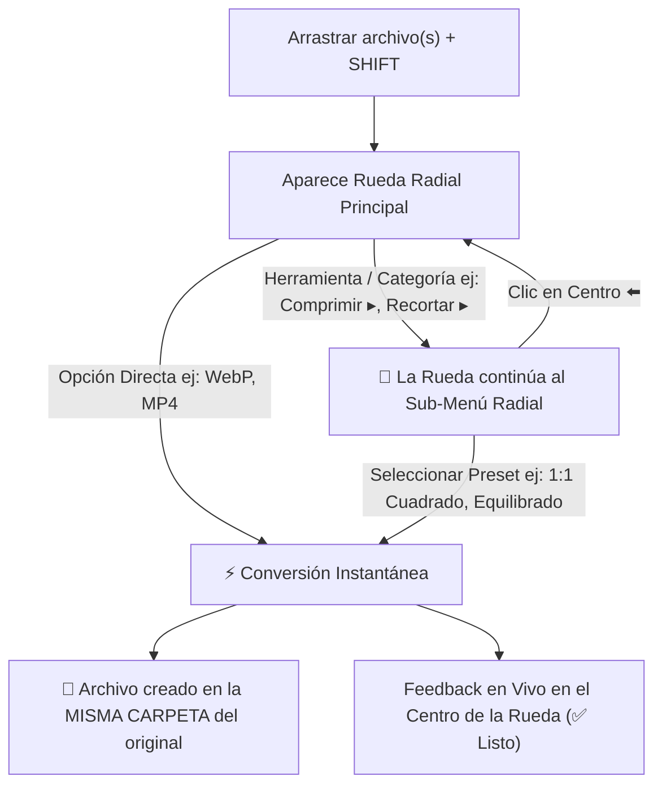

# ⚡ ShiftDrop — Conversor y Editor Radial Local para Windows

> Convierte, recorta, comprime y combina archivos al instante simplemente arrastrándolos mientras mantienes pulsada la tecla **Shift**.

---

## 🎯 ¿Qué es ShiftDrop?

**ShiftDrop** es una herramienta de productividad nativa para Windows inspirada en la agilidad de los menús circulares (Pie / Radial Menus). Te permite realizar cientos de conversiones y ajustes rápidos sobre imágenes, vídeos, audios y documentos PDF directamente desde el Explorador de Windows o el Escritorio, **sin abrir pesados programas y sin subir tus archivos a ningún servidor externo** (100% privado y offline).

---

## 🚀 Flujo de Uso Continuo (Cascading Radial Workflow)



1. **Arrastra** cualquier archivo desde el Explorador o Escritorio manteniendo **`Shift`**.
2. **Se abre la Rueda Radial**. Puedes soltar sobre un formato directo (`⚡ WebP`, `🎬 MP4`) para **conversión instantánea en ese mismo momento**.
3. **Navegación Radial Continua:** Si eliges una opción con más ajustes (ej: `🗜️ Comprimir ▸`, `✂️ Recortar ▸`, `⏱️ Trim ▸`, `✨ Más Formatos ▸`), **la rueda no se cierra**: se transforma fluidamente en una sub-rueda radial con presets instantáneos (`1:1 Cuadrado`, `16:9`, `70% Equilibrado`, `15s`, etc.).
4. **Al seleccionar el preset, la conversión se ejecuta de inmediato**.
5. **Misma Carpeta Garantizada:** El nuevo archivo siempre se genera exactamente en la misma ruta/carpeta donde reside el archivo original.
6. **Feedback en vivo:** El centro de la rueda muestra la animación de progreso (`⚡ Convirtiendo...`) y el estado final (`✅ ¡Listo!`), cerrándose automáticamente tras completar la tarea.
7. *¿Deseas volver atrás en cualquier momento?* Haz clic o suelta en el centro (`⬅️ Volver`) o pulsa `Escape`.

---

## 🛠️ Capacidades y Herramientas Integradas

### 🖼️ Imágenes
* **Formatos:** WebP, PNG (con transparencia), JPG/JPEG (calidad personalizable), ICO (icono Windows multi-resolución), BMP, TIFF, GIF, PDF.
* **Comprimir:** Reducción adaptativa de peso sin pérdida visible.
* **Recortar y Escalar (HUD):** Proporciones estándar (`1:1 Cuadrado`, `16:9 Panorámico`, `9:16 Stories`, `4:3 Foto`) y escala porcentual (`25%`, `50%`, `75%`, `100%`).
* **Imágenes a PDF:** Convierte una o múltiples imágenes en un único documento PDF.

### 🎬 Vídeos
* **Formatos:** MP4 universal (`H.264 + AAC`), WebM (`VP9 + Opus`), MOV, MKV, AVI.
* **GIF Animado:** Conversión en dos pasadas con generación de paleta dinámica de alta calidad.
* **Extraer Audio:** Extrae la pista de sonido en MP3 a 320 kbps o en formato WAV sin pérdida.
* **Comprimir Vídeo:** Algoritmo CRF con preservación de calidad y reducción drástica de MB.
* **Ajustar Duración / Trim (HUD):** Selector visual de punto de inicio y duración con presets rápidos (`15s`, `30s`, `1 min`).

### 🎵 Audios
* **Formatos:** MP3 (320 kbps), WAV (Studio Master PCM), FLAC (Lossless Hi-Fi), M4A / AAC, OGG, Opus.
* **Normalizar Volumen:** Estandarización de volumen uniforme según la norma de radiodifusión EBU R128.
* **Recortar Audio (HUD):** Ajuste de fragmentos y tonos de llamada.

### 📄 Documentos y PDFs
* **Combinar PDFs (HUD):** Si arrastras varios PDFs, el menú te permite reordenarlos interactivamente antes de fusionarlos en uno solo.
* **Extraer a Imágenes:** Convierte cada una de las páginas del PDF en imágenes PNG o JPG de alta resolución.
* **Comprimir PDF:** Optimización de flujos y eliminación de objetos redundantes.
* **Dividir PDF:** Separa el documento en páginas individuales o rangos.

### ✨ Catálogo con 100+ Formatos
* Si necesitas un formato específico no listado en el anillo primario, suelta en **`✨ Más...`** para abrir el buscador instantáneo de formatos.

---

## 🔒 100% Offline y Privado

ShiftDrop funciona de forma totalmente autónoma:
* **Motor Multimedia:** Binario estático optimizado de FFmpeg 7.1 empaquetado localmente.
* **Motor Gráfico:** Pillow (PIL) de alto rendimiento.
* **Motor Documental:** PyMuPDF y PyPDF para tratamiento de vectores y páginas.
* Tus datos nunca salen de tu ordenador.

---

## 📦 Ejecución

Para iniciar la aplicación:
```powershell
cd C:\Users\Gamer\ShiftDrop
uv run python -m shiftdrop.main
```
O simplemente haz doble clic en el archivo [`ShiftDrop.bat`](file:///C:/Users/Gamer/ShiftDrop/ShiftDrop.bat).
