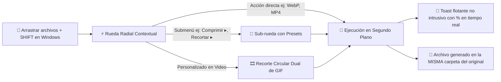

# ⚡ ShiftDrop — Conversor y Editor Radial Local para Windows

[](https://www.python.org/)
[](https://riverbankcomputing.com/software/pyqt/)
[](https://ffmpeg.org/)
[](https://github.com/SYSTRAN/faster-whisper)
[](https://www.microsoft.com/windows)
[](https://github.com/DanteJac/ShiftDrop)
[](LICENSE)

> Convierte, recorta, comprime, transcribe y combina archivos al instante en Windows simplemente arrastrándolos mientras mantienes presionada la tecla **Shift**. Sin subir datos a la nube, sin publicidad y con ejecución 100% en segundo plano.

---

## 📑 Tabla de Contenidos

- [🎯 ¿Qué es ShiftDrop?](#-qué-es-shiftdrop)
- [✨ Características Principales](#-características-principales)
- [🎬 Modo Recorte GIF Interactivo en Rueda](#-modo-recorte-gif-interactivo-en-rueda)
- [🧠 Arquitectura Técnica e Ingeniería](#-arquitectura-técnica-e-ingeniería)
- [📦 Capacidades y Formatos Soportados](#-capacidades-y-formatos-soportados)
- [📂 Estructura del Proyecto](#-estructura-del-proyecto)
- [🚀 Instalación y Puesta en Marcha](#-instalación-y-puesta-en-marcha)
- [🧪 Pruebas Automatizadas](#-pruebas-automatizadas)
- [🛠️ Compilación y Empaquetado (PyInstaller)](#️-compilación-y-empaquetado-pyinstaller)
- [👤 Autor y Contacto](#-autor-y-contacto)
- [📄 Licencia](#-licencia)

---

## 🎯 ¿Qué es ShiftDrop?

**ShiftDrop** es una herramienta de productividad nativa para Windows inspirada en la agilidad ergonómica de los menús circulares (*pie / radial menus*) de software profesional (Blender, Maya, videojuegos). 

Detecta de forma global cuando arrastras uno o varios archivos desde el **Explorador de Windows** o el **Escritorio** mientras mantienes presionada la tecla **`Shift`**, desplegando al instante una rueda circular interactiva bajo el cursor adaptada dinámicamente al tipo de archivo detectado.



---

## ✨ Características Principales

- **⚡ Acceso por Gesto Global:** Arrastra con `Shift` desde cualquier carpeta de Windows para desplegar la rueda. Si sueltas fuera o presionas `Escape`, se cierra limpiamente sin interferir con tu flujo de trabajo.
- **🔒 Privacidad y Procesamiento 100% Offline:** Tus archivos nunca salen de tu ordenador. Todo el renderizado y codificación se ejecuta localmente mediante FFmpeg 7.1, Pillow, PyMuPDF y Whisper.
- **🪟 Ejecución No Intrusiva en Segundo Plano:**
  - Al seleccionar una acción, la rueda radial se oculta automáticamente.
  - La notificación flotante (*Toast*) cuenta con `WA_ShowWithoutActivating` y `WindowDoesNotAcceptFocus`, permitiéndote seguir jugando, escribiendo o navegando sin sufrir robos de foco.
  - El botón *"📁 Abrir carpeta"* selecciona y resalta de inmediato el archivo final en el Explorador de Windows.
- **🛡️ Prevención de Pérdida de Datos:**
  - Se fuerza `DropAction.CopyAction` a nivel OLE para garantizar que Windows Explorer **nunca mueva ni elimine los archivos originales**.
  - Política de nombres no destructiva: si un archivo ya existe, se genera automáticamente con sufijo incremental `(1)`, `(2)`, preservando la fuente.
- **📚 Procesamiento por Lotes y Multifrecuencia:** Soporte automático para seleccionar decenas de imágenes, documentos, hojas de cálculo o archivos mixtos para unificarlos en PDF, convertirlos masivamente o extraer contenido.
- **🎙️ Transcripción por Inteligencia Artificial Local:** Integración con `faster-whisper` (CTranslate2) para transcribir notas de voz, conferencias o videos a texto (`TXT`), subtítulos sincronizados (`SRT`) o documentos formateados (`DOCX`).

---

## 🎬 Modo Recorte GIF Interactivo en Rueda

A diferencia de los programas tradicionales que abren pesadas ventanas de diálogo modales, ShiftDrop integra un **selector visual circular concéntrico de tramos de video**:

```
                       [ 12:00 ]
                     . - ~ ~ ~ - .
                 . '   PISTA FIN   ' .  <- Pista Exterior (Magenta #FF2A85)
               /     . - ~ ~ ~ - .     \
              /    /   PISTA INICIO \    \ <- Pista Interior (Cian #00E5FF)
             |    |     [ Centro ]   |    | <- Duración calculada (ej: 4.5s)
              \    \   (Click Crear)/    /
               \     ' - _ _ _ - '     /
                 . '                 ' .
                     ' - _ _ _ - '
```

- **Pista Interior (Cian `#00E5FF`):** Ajusta con arrastre continuo el segundo exacto de inicio del GIF.
- **Pista Exterior (Magenta `#FF2A85`):** Ajusta el punto de finalización.
- **Sector resaltado:** Conecta visualmente el tramo comprendido entre inicio y fin con sombreado degradado.
- **Pastillas rápidas de duración:** Botones `+5s`, `+10s`, `+15s` y `Todo` para selección a un clic.
- **Paleta de alta calidad:** Codificación FFmpeg en dos pasadas (`palettegen` + `paletteuse`) a 15 FPS con tramado óptimo sin efecto banding.

---

## 🧠 Arquitectura Técnica e Ingeniería

El proyecto está diseñado bajo una arquitectura modular y desacoplada:

```
ShiftDrop/
├── shiftdrop/
│   ├── listener/          # Detección global de gestos en Windows
│   │   ├── drag_listener.py     # Hilo Win32 GetAsyncKeyState (~33Hz / 0.0% CPU)
│   │   └── explorer_helper.py   # Consulta COM IShellWindows a carpetas activas
│   ├── ui/                # Renderizado vectorial puro sobre PyQt6
│   │   ├── radial_menu.py       # Rueda radial con coordenadas polares y QPainter
│   │   ├── slice_definition.py  # Árbol jerárquico de opciones y submenús
│   │   ├── toast.py             # Notificación flotante de estado en segundo plano
│   │   └── dialogs/             # Cuadros de catálogo y configuración extendida
│   ├── core/              # Motores de conversión y transformación local
│   │   ├── dispatcher.py        # Enrutador central e inspección de magic bytes
│   │   ├── ffmpeg_helper.py     # Wrapper de FFmpeg con drenado de pipes en vivo
│   │   ├── image_ops.py         # Tratamiento gráfico con Pillow
│   │   ├── video_ops.py         # Codificación de video y paletas de GIF
│   │   ├── audio_ops.py         # Procesamiento acústico y normalización EBU R128
│   │   ├── pdf_ops.py           # Fusión y rasterizado vectorial con PyMuPDF
│   │   ├── doc_ops.py           # Conversiones Office y PDF a DOCX
│   │   ├── excel_ops.py         # Automatización de hojas de cálculo y tablas
│   │   ├── transcribe_ops.py    # Inferencia local Speech-to-Text con Whisper
│   │   └── multi_ops.py         # Operaciones por lotes y combinaciones masivas
│   ├── app_tray.py        # Orquestador principal, bandeja y QThreadPool
│   └── main.py            # Punto de entrada de la aplicación
```

### Principios de Ingeniería Destacados:
1. **Detección de Archivos sin Foco:** Mediante llamadas a la API de Windows (`user32.dll` y la interfaz COM `Shell.Application`), ShiftDrop inspecciona qué archivos están seleccionados en el Explorador sin forzar activación de ventana, evitando cancelar el arrastre de Windows.
2. **Pipeline Asíncrono no Bloqueante:** Todas las tareas pesadas se delegan a un `QThreadPool` con `QRunnable` (`ConversionWorker`). La interfaz nunca sufre congelamiento (*not responding*).
3. **Drenado Seguro de Subprocesos:** El wrapper de FFmpeg drena simultáneamente `stdout` y `stderr` en hilos demonio separados para evitar bloqueos por búfer lleno de pipe de Windows en archivos multimedia pesados.
4. **Detección por Magic Bytes:** La categorización de archivos inspecciona firmas binarias reales (cabeceras `%PDF`, `PK\x03\x04`, `\x89PNG`, `\xff\xd8\xff`, etc.) para clasificar archivos correctamente incluso si tienen extensiones incorrectas o faltantes.

---

## 📦 Capacidades y Formatos Soportados

| Categoría | Formatos de Entrada | Formatos y Operaciones de Salida | Motor |
| :--- | :--- | :--- | :--- |
| **🖼️ Imágenes** | JPG, PNG, WebP, ICO, BMP, TIFF, GIF, HEIC | WebP, PNG (transparente), JPG (calidad variable), ICO multi-resolución, BMP, PDF, recorte 1:1, 16:9, 9:16, 4:3 y compresión adaptativa. | `Pillow` |
| **🎬 Video** | MP4, MKV, MOV, WebM, AVI, FLV, WMV, TS | MP4 (H.264+AAC), WebM (VP9+Opus), GIF dinámico con selector circular, extracción de audio a MP3/WAV, compresión CRF sin pérdida perceptible, recorte de tramo. | `FFmpeg 7.1` |
| **🎵 Audio** | MP3, WAV, FLAC, M4A, AAC, OGG, Opus, AIFF | MP3 (320 kbps), WAV PCM estudio, FLAC Hi-Fi sin pérdida, M4A, normalización de sonoridad estándar EBU R128, recorte de fragmentos. | `FFmpeg 7.1` |
| **📑 PDFs** | PDF (uno o múltiples) | Fusión ordenada de PDFs, extracción de páginas a imágenes PNG/JPG, compresión de flujos, división en páginas o rangos, conversión a DOCX editable. | `PyMuPDF` + `pdf2docx` |
| **📝 Documentos** | DOCX, DOC, TXT, RTF, ODT, MD | Conversión a PDF, exportación a DOCX limpio, extracción de texto plano. | `python-docx` + COM |
| **📊 Excel / Tablas**| XLSX, XLS, XLSM, CSV, TSV, ODS | Conversión a PDF estructurado, DOCX, CSV tabular, JSON y tablas web HTML. | `openpyxl` + `xlsxwriter` |
| **🎙️ Transcripción** | Cualquier archivo de audio o video | Transcripción Speech-to-Text local a TXT, subtítulos con marcas de tiempo SRT y documento Word DOCX. | `faster-whisper` |

---

## 🚀 Instalación y Puesta en Marcha

### Prerrequisitos
- **Sistema Operativo:** Windows 10 o Windows 11 (64-bit).
- **Python:** Versión 3.12 o superior.
- Recomendado: Administrador de paquetes [`uv`](https://github.com/astral-sh/uv) para instalación ultra-rápida.

### 1. Clonar el Repositorio
```powershell
git clone https://github.com/DanteJac/ShiftDrop.git
cd ShiftDrop
```

### 2. Crear Entorno Virtual e Instalar Dependencias
Con `uv` (recomendado):
```powershell
uv venv .venv
.\.venv\Scripts\activate
uv sync
```
O con `pip` tradicional:
```powershell
python -m venv .venv
.\.venv\Scripts\activate
pip install -r pyproject.toml
```

### 3. Ejecutar ShiftDrop
```powershell
python -m shiftdrop.main
```
También puedes hacer doble clic en el lanzador rápido [`ShiftDrop.bat`](ShiftDrop.bat).

---

## 🧪 Pruebas Automatizadas

El proyecto cuenta con una suite completa de más de 118 pruebas unitarias y de integración que cubren la rueda radial, el recorte de GIF, notificaciones de segundo plano, seguridad OLE y operaciones multimedia:

```powershell
.\.venv\Scripts\python.exe -m unittest discover tests
```

---

## 🛠️ Compilación y Empaquetado (PyInstaller)

Para generar una distribución portátil autónoma (`onedir`) que incluya todos los binarios nativos (FFmpeg, modelos y librerías C++):

```powershell
.\.venv\Scripts\pyinstaller.exe ShiftDrop.spec --noconfirm
```

El ejecutable optimizado se generará en:
```
dist/ShiftDrop/ShiftDrop.exe
```

---

## 👤 Autor y Contacto

Desarrollado y mantenido con dedicación por **DanteJac**.

- **GitHub:** [@DanteJac](https://github.com/DanteJac)
- **Correo Electrónico:** [jacobo.bustos.22@gmail.com](mailto:jacobo.bustos.22@gmail.com)
- **Repositorio:** [https://github.com/DanteJac/ShiftDrop](https://github.com/DanteJac/ShiftDrop)

---

## 📄 Licencia

Este proyecto está bajo la Licencia [MIT](LICENSE). Eres libre de usar, modificar y distribuir esta herramienta respetando los términos de autoría.
